# LogoBench

**A local-first workbench for logo designers: upload a logo, get a structured AI critique, and turn it into a small,
client-ready brand identity (palette, type, mockups, export files and an offline identity page).**

[](https://github.com/arikurniawan7798/LogoBench/actions/workflows/ci.yml)
[](LICENSE)
[](package.json)

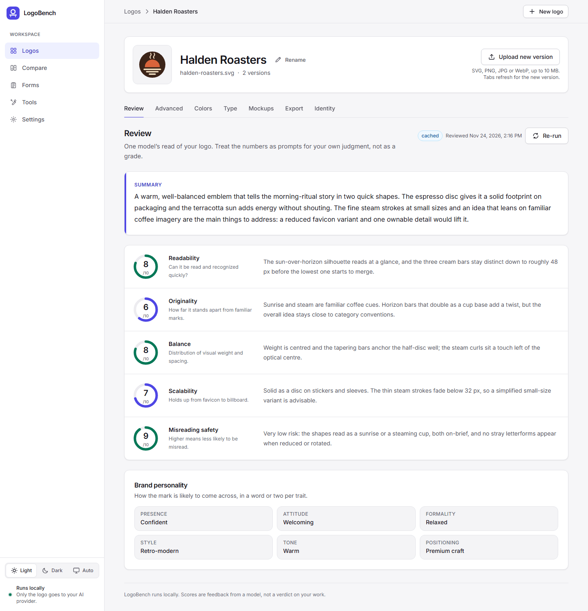

LogoBench is a single-user app that runs on your own machine (it listens on `127.0.0.1` only). The AI model gives an
opinion; everything else (color extraction, contrast checks, mockups, exports, PDF and zip files) is deterministic
code. All brands in the screenshots are invented demo data from `npm run seed:demo`.

## What it does

- **Review**: five scores out of 10 (readability, originality, balance, scalability, misreading safety), each with a
  one-sentence reason, plus a summary and a six-trait brand-personality read.
- **Advanced review**: prioritized fixes, a pre-delivery checklist and presentation ideas, read against the project brief,
  with a designed, multi-page **PDF report**.
- **Compare** 2 or 3 concepts side by side, scored on the same dimensions, with a recommended pick and notes.
- **Colors**: palette extracted from the logo and sorted into main, support and neutral roles; HEX, RGB and CMYK
  (CMYK is a naive conversion, labelled approximate); optional AI naming; editable; contrast ratios against your neutrals.
- **Typography**: heading, body and optional accent fonts from a curated list of 41 Google Fonts, with a computed web and
  social size scale.
- **Mockups**: website header, mobile screen, app icon, favicon in a browser tab and business card, rendered as PNG
  with the logo, the project name and your saved colors.
- **Export**: a logo pack zip (cleaned SVG, recolored SVG variants, transparent PNGs at 256/512/1024 px, a JPG and
  favicons including `favicon.ico`), plus standalone favicon and background generators on the Tools page.
- **Client forms**: build questionnaires, fill them per project; answers become part of the brief the model reads.
- **Create identity**: one click runs review, colors, type, mockups and the identity bundle in sequence and streams
  progress; the result is a zip with a single `index.html` brand page (logo, palette, type, mockups, fonts) that
  works offline.
- **History**: projects keep every uploaded version; rename a project at any time (mockups and exports use the name);
  reviews and compares are stored.
- **Light, Dark and Auto** themes.

## Screenshots

| | |
|---|---|
| 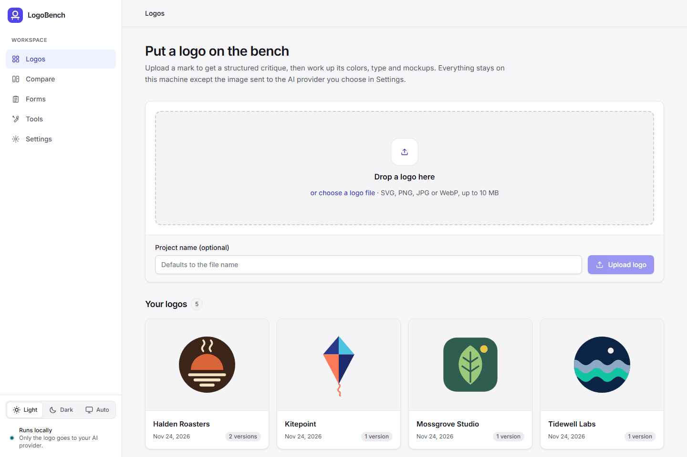 Logos | 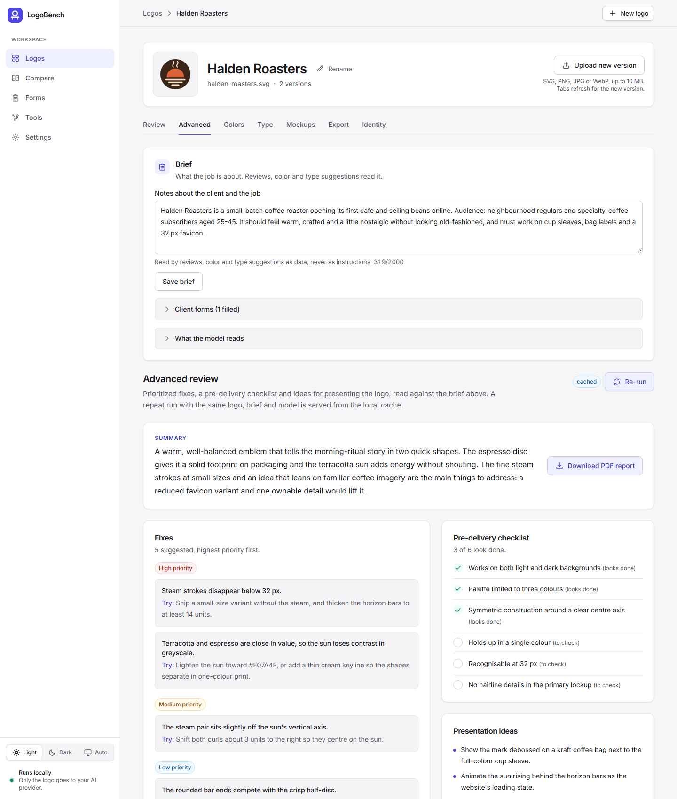 Advanced review |
| 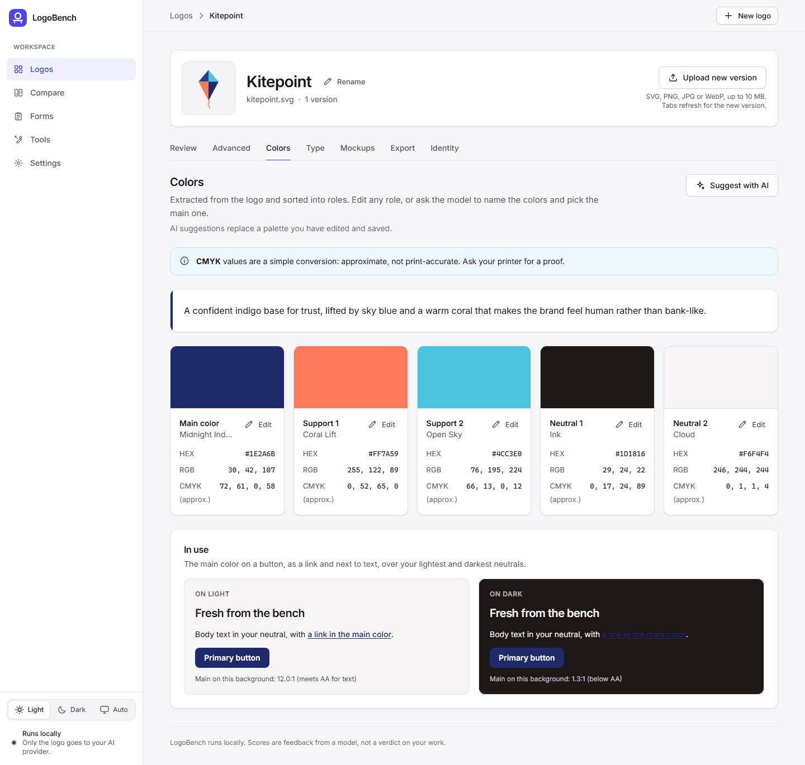 Colors | 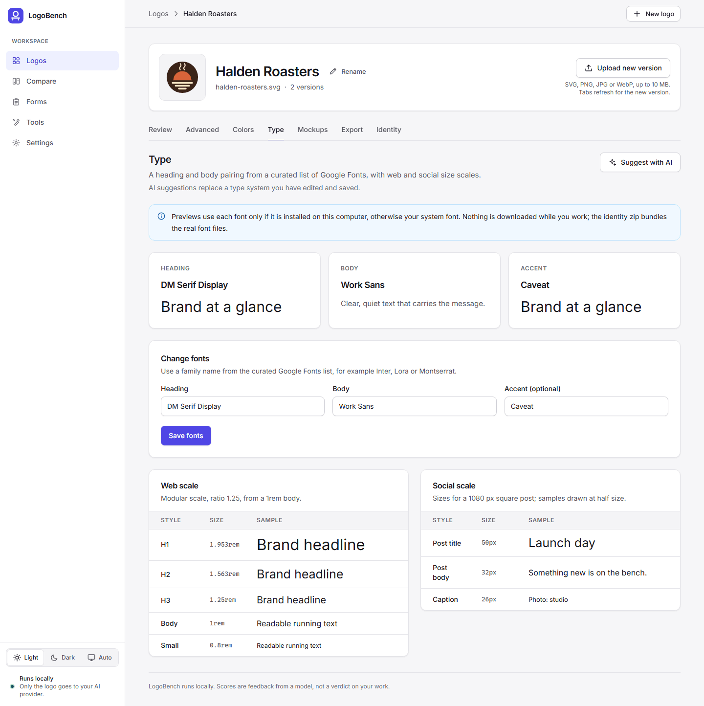 Type |
| 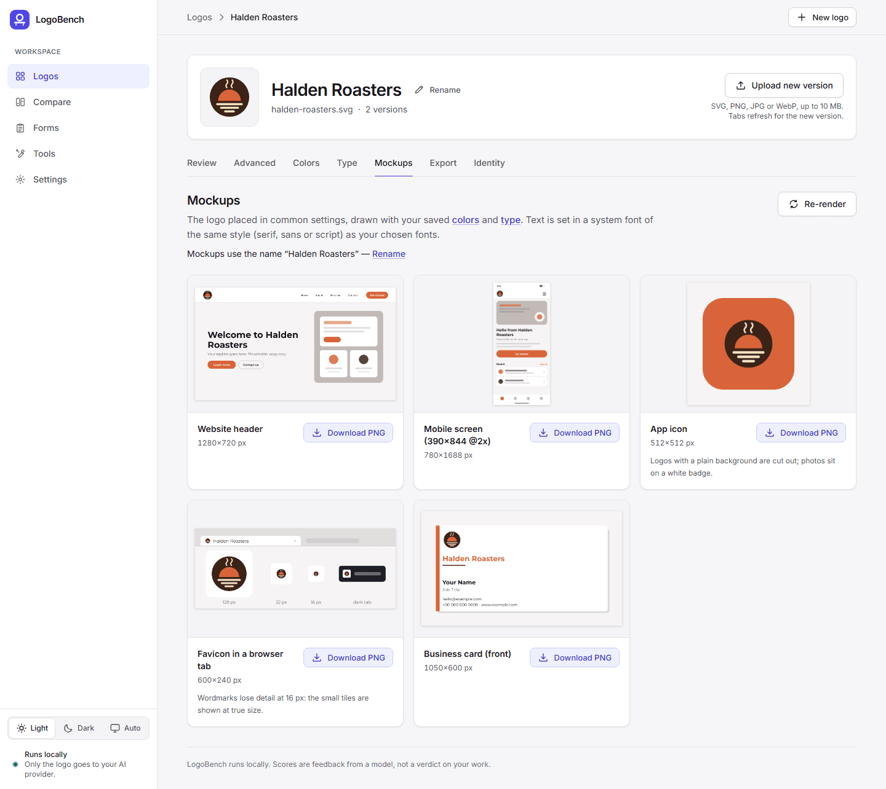 Mockups | 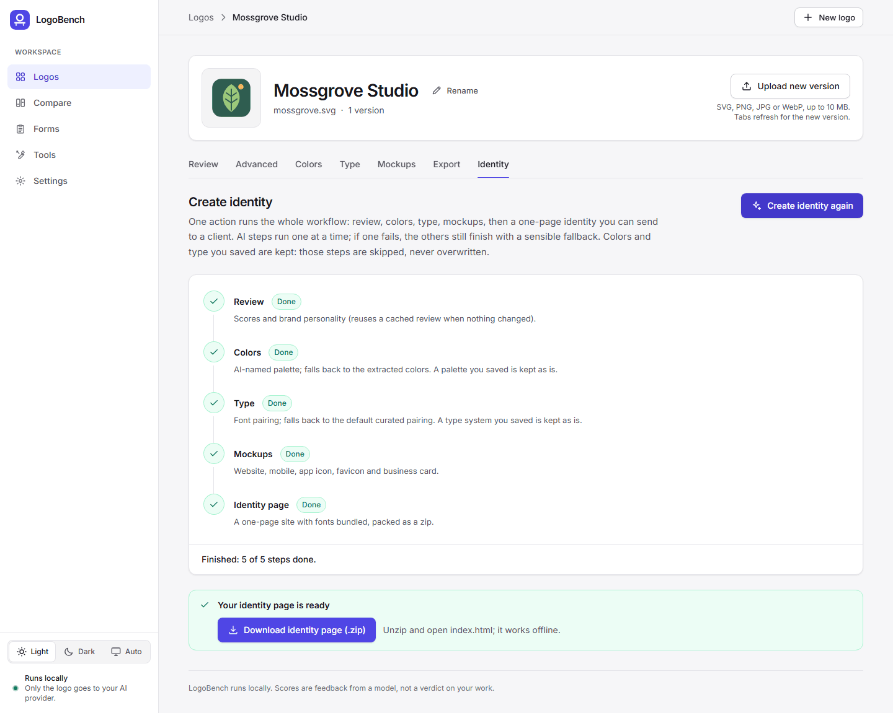 Create identity |
| 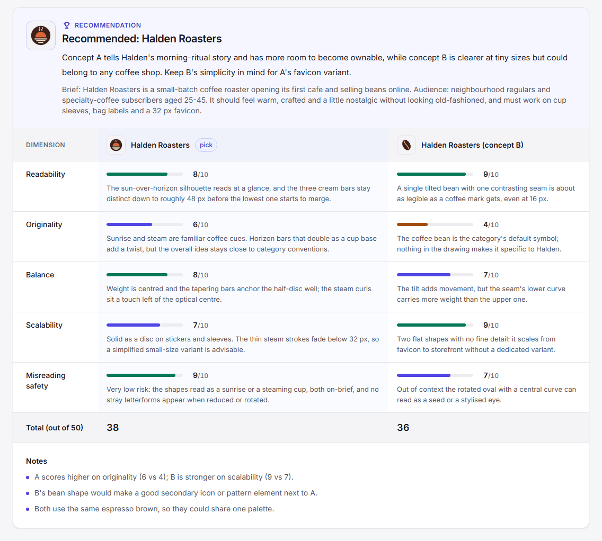 Compare | 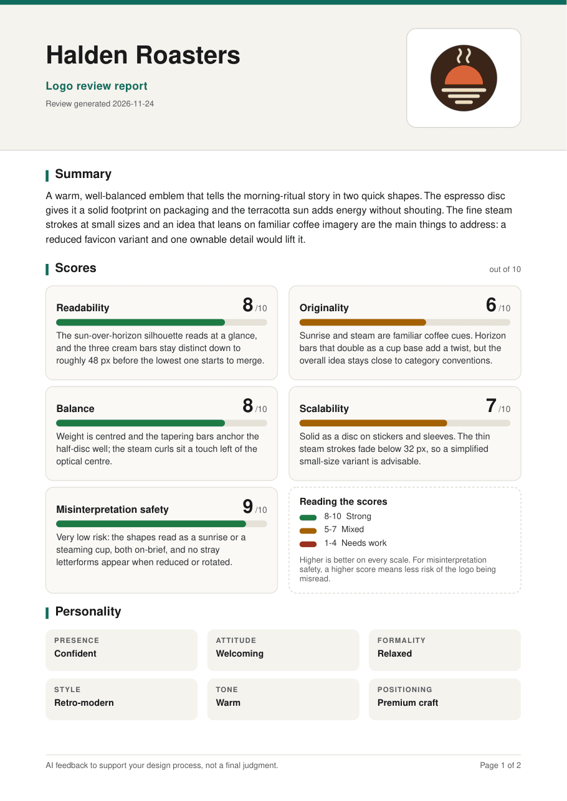 PDF report |
| 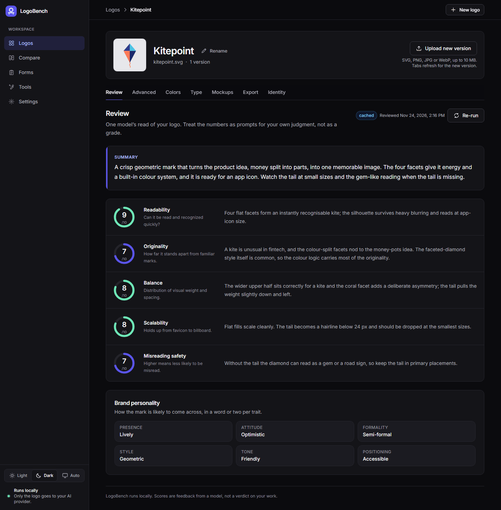 Dark mode | 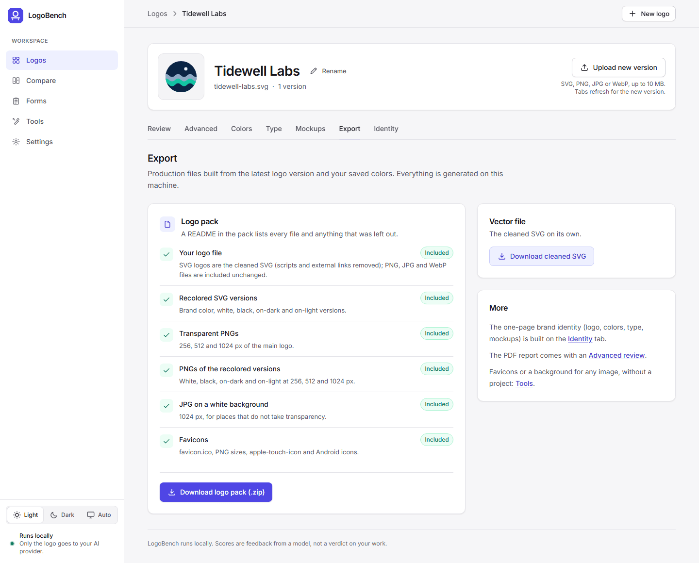 Export |

## Quick start

Requirements: Node.js 20.19 or newer (CI uses Node 22).

```sh
git clone https://github.com/arikurniawan7798/LogoBench.git
cd LogoBench
npm install
cp .env.example .env        # Windows: copy .env.example .env
# put your key in .env:  GEMINI_API_KEY=...
npm start
```

Open http://127.0.0.1:3001. A free-tier [Gemini API key](https://aistudio.google.com/apikey) works, or use a local
[Ollama](https://ollama.com) model instead (see [Configuration](#configuration)).

### Try it without an API key

```sh
npm install
npm run seed:demo           # writes invented demo brands to data-demo/ (your data/ is never touched)
npm run start:demo          # same as DATA_DIR=data-demo npm start; works in cmd, PowerShell and POSIX shells
```

The demo has five projects (one with two versions) with reviews, palettes, type systems, briefs, a filled client form and
a stored comparison; reviews, colors, type, mockups, exports and the comparison can all be browsed without a key.
Anything that asks the model for something new needs a key: Run review / Re-run, Run advanced review, Suggest with AI,
a new comparison, and the AI steps of Create identity (which then fall back to the saved palette and type). The seed
also stores advanced reviews, so each project's PDF report is available at `/api/projects/<id>/report.pdf`, but the
Advanced tab only shows a result after a run. The identity zip downloads its fonts from Google Fonts when it is built.
`npm run seed:demo` refuses to write into a non-empty folder; `npm run seed:demo -- --force` recreates the demo data.

For development, `npm run dev` starts the API with reload plus the Vite dev server on http://localhost:5173 (which proxies
`/api` to port 3001).

## Tech stack

| Layer | Tools |
|---|---|
| Web | React 18, TypeScript, Vite 5, Tailwind CSS v4 (`@tailwindcss/vite`), bundled Inter font (no CDN requests) |
| API | Node.js, Express 4, TypeScript run with `tsx`, multer (uploads), zod 4 (validation of requests, stored files and model output) |
| AI | `Provider` interface with Gemini (REST via `fetch`) and Ollama adapters |
| Images and files | sharp (rasterizing, color extraction, mockups, PNG/JPG/ICO), pdfkit (PDF report), fflate (zips), fast-xml-parser (SVG sanitizing) |
| Storage | Plain JSON and image files under `DATA_DIR` |
| Tests | Vitest, supertest, Testing Library, jsdom; GitHub Actions on Ubuntu |

## Architecture

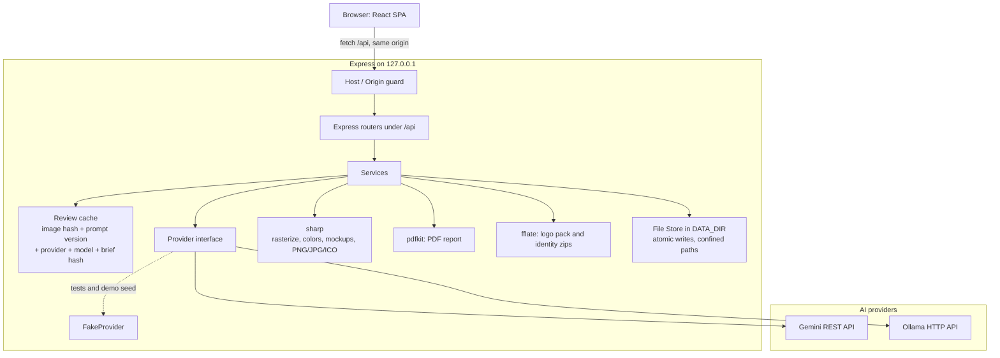

The browser only talks to the local Express server. In production (`npm start`) Express also serves the built SPA;
in development Vite serves it and proxies `/api`. Model calls go through one `Provider` interface (`generateJson`
with a zod schema), so Gemini, Ollama and the test fake are interchangeable. Reviews are cached on disk under a key built
from `sha256(image bytes)`, the prompt version, the provider, the model and `sha256(brief)`, and identical requests
that arrive at the same time share one model call.

**Create identity, step by step.** `POST /api/projects/:id/create-identity` runs five steps strictly one after another
and streams a `data: {json}` frame per event (`text/event-stream` framing, read with `fetch` and a stream reader):

1. **review**: reuses the cached review when nothing changed.
2. **colors**: AI-named palette; on failure falls back to the colors extracted from the logo (or a neutral default).
3. **type**: AI font pairing; on failure falls back to a curated default pairing.
4. **mockups**: renders all five mockups with the resulting palette and font style.
5. **identity**: builds the offline zip; the Google Fonts files are downloaded at this point (and cached) and embedded.

A failed step is reported with a code and message and the remaining steps still run. A palette or type system you saved
yourself is never overwritten (those steps are skipped). Only one run per project at a time (a second gets 409).

## Engineering highlights

- **SVG sanitizer** (`server/src/svg.ts`): parses uploads and drops scripts, `foreignObject`, embeds, animation elements,
  comments and `on*` handlers. An `href`/`src` survives only as a same-document `#` reference, matched on the local
  attribute name so aliased namespace prefixes are covered too; CSS escapes are decoded before `url(...)`, `@import`,
  `expression(` and `javascript:` are stripped from styles. Illustrator-style DOCTYPEs with simple internal entities are
  expanded under caps on entity count, entity size and total expansion; external, parameter or nested entities are
  refused. Hostile fixtures (billion laughs, external entity) are part of the tests.
- **Prompt-injection fencing**: the brief and filled forms are wrapped in `<brief>` tags and described to the model as
  data; text inside the logo image is declared content, never instructions; personality notes fed into the type prompt
  are fenced, single-line and stripped of angle brackets.
- **Validated structured output**: the model's JSON is extracted (fence- and prose-tolerant), validated with zod and
  retried once on invalid output; color and type answers are checked per field (only extracted hex values and curated
  font names are accepted) with deterministic fallbacks.
- **Rate limits and outages**: exponential backoff for 429 and 503 responses that honors the server's retry hint
  (`Retry-After` or Gemini's `RetryInfo`), but fails fast with the wait time when it asks for more than 20 seconds.
- **Review cache and in-flight dedupe**: repeat reviews are served from disk, and simultaneous identical review or
  compare requests share one model call.
- **DNS-rebinding and CSRF guard**: only `Host` values `127.0.0.1`, `localhost` or `[::1]` on the configured port are
  served, and state-changing requests with a foreign `Origin` are refused.
- **Storage safety**: every write goes to a temp file and is renamed into place; the store refuses any path that resolves
  outside `DATA_DIR`; ids are validated; uploads are sniffed by magic bytes, not by extension.
- **Secrets**: the Gemini key is sent in a request header, never returned to the browser (Settings only reports whether
  one is set), and redacted from provider error messages.
- **Accessibility**: WAI-ARIA tabs with arrow/Home/End keys, a dialog that manages focus, labelled regions and live
  status messages, contrast ratings in the Colors tab, and `prefers-reduced-motion` support.
- **Tests**: 411 (351 server, 60 web), including an end-to-end smoke test that uploads, reviews, builds mockups and
  downloads both zips over the real HTTP stack with a fake provider and a fake font server, so the suite needs no network.
- **A Windows test-runner crash, worked around**: on the Windows development machine (Node 24), a process opening many
  loopback TCP connections occasionally died with a native fast-fail (exit code `0xC0000409`, no JS error), roughly once
  per 7,000 to 20,000 connections. The test helper (`server/tests/helpers/request.ts`) serves the app over an IPC
  socket instead (a named pipe on Windows, a Unix socket elsewhere), which removed the flaky "worker exited" failures.

## Design decisions and trade-offs

- **Files instead of a database.** One user, a few hundred records at most, and data that people want to back up or
  inspect. JSON files plus atomic renames keep the app dependency-free and the data portable (copy the folder). The cost:
  no queries or indexes, and per-project write serialization is done in process.
- **Local only.** Logos are often unreleased client work. Binding to loopback, with a Host/Origin guard, avoids accounts,
  auth and hosting entirely; the only outbound traffic is the AI provider you choose and Google Fonts at identity export.
- **Swappable provider.** A small `Provider` interface keeps prompts and validation in one place, lets Ollama run fully
  offline, and makes every feature testable with a deterministic fake.
- **AI for judgment, code for everything else.** Palettes are extracted, the type scale is computed, mockups and files
  are rendered by code, so results are reproducible and the model cannot invent colors or fonts outside the lists.

## Known limitations and roadmap

- Single user on one machine: there is no auth, no per-user storage and no quotas. Hosting it for others would need all
  three, plus moving the API key and rate limiting server-side per user.
- The default Gemini model name (`gemini-3.6-flash`, in `server/src/config.ts`) and free-tier availability change over
  time; check it against the current Gemini documentation. You can change the model in Settings without a restart.
- Ollama support is best-effort: local vision models follow the JSON format less reliably than Gemini.
- The PDF report uses built-in Helvetica, so it covers Latin text only (other glyphs become `?`).
- Type previews in the app use fonts installed on your computer (nothing is downloaded while you work); only the identity
  zip embeds the real font files.
- Recolored logo variants and final production files need an SVG source; raster uploads can be reviewed but some export
  files are skipped (the export lists them).
- CMYK values are a naive conversion, not print-accurate.
- The test suite was developed on Windows; CI runs it on Ubuntu.

## Testing

```sh
npm test                      # server (vitest + supertest) and web (vitest + Testing Library) suites
npx tsc --noEmit -p server    # type-check the server, tests and scripts
npm run build                 # type-check the server, type-check and build the web app
```

Automated tests use a fake AI provider and a fake font server, so no key or network is needed. CI runs the same three
commands on every push and pull request (`.github/workflows/ci.yml`).

## Project structure

```
LogoBench/
├── server/                  Express API (TypeScript, run with tsx)
│   ├── src/
│   │   ├── ai/              Provider interface, Gemini, Ollama, FakeProvider, JSON validation and backoff
│   │   ├── review/          review and advanced review: prompts, zod schemas, cache
│   │   ├── colors/          extraction, roles, HEX/RGB/CMYK
│   │   ├── type/            curated pairings and size scale
│   │   ├── mockups/         SVG templates rendered with sharp
│   │   ├── export/          logo pack, favicons, backgrounds, recoloring
│   │   ├── identity/        Create identity workflow and offline bundle
│   │   ├── report/          PDF report
│   │   ├── compare/         2-3 concept comparison
│   │   ├── routes/          Express routers
│   │   └── svg.ts, hostcheck.ts, storage.ts, projects.ts, forms.ts, settings.ts, ...
│   ├── data-static/         curated Google Fonts list
│   ├── scripts/             seed-demo.ts and the demo brands
│   └── tests/               server tests and fixtures
├── web/                     React SPA
│   └── src/                 pages/, components/ui/, api.ts, theme.ts, __tests__/
├── docs/
│   ├── screenshots/         images used in this README
│   └── superpowers/         original design spec and implementation plan
└── .github/workflows/ci.yml
```

## Configuration

**Gemini API key.** Copy `.env.example` to `.env` in the repository root and set `GEMINI_API_KEY`, then restart. `.env`
is gitignored and holds the key in plaintext. Optional variables in the same file: `PORT` (default 3001) and `DATA_DIR`
(default `data/`; a relative path is resolved from the repository root). The Settings screen only shows whether a key is
configured. The server's settings API also accepts a `geminiKey`, which would be stored in plaintext in
`data/settings.json` and take precedence over `.env`, but the app itself does not use this.

**Ollama.** In Settings, choose the Ollama provider, set the URL (default `http://127.0.0.1:11434`) and a vision model
(default `llama3.2-vision`; pull it first with `ollama pull llama3.2-vision`).

**Your data.** Projects, logo versions, reviews, palettes, type systems, forms, compares and settings live under
`data/` (gitignored). To back up or move your work, copy that folder, or point `DATA_DIR` elsewhere.

**Privacy.** With Gemini selected, the logo (as a downscaled PNG) and the brief are sent to Google for each AI call.
With Ollama, AI calls stay on your machine as long as the Ollama URL points to it. The identity zip downloads its fonts
from Google Fonts at export time (that request carries only the font names); the zip itself works offline. Nothing else
leaves the machine. Open the app as `127.0.0.1`, `localhost` or `[::1]`; other host names get a 403.

**Uploads.** SVG, PNG, JPG or WebP up to 10 MB. Illustrator "Save As" SVGs are accepted; SVGs whose DOCTYPE uses
external or nested entities are refused (re-export with File > Export > SVG).

**Known issue on Windows.** The loopback crash described above can, rarely, also take down the running server. If the
server disappears, start it again; your data is on disk.

## License

[MIT](LICENSE)
